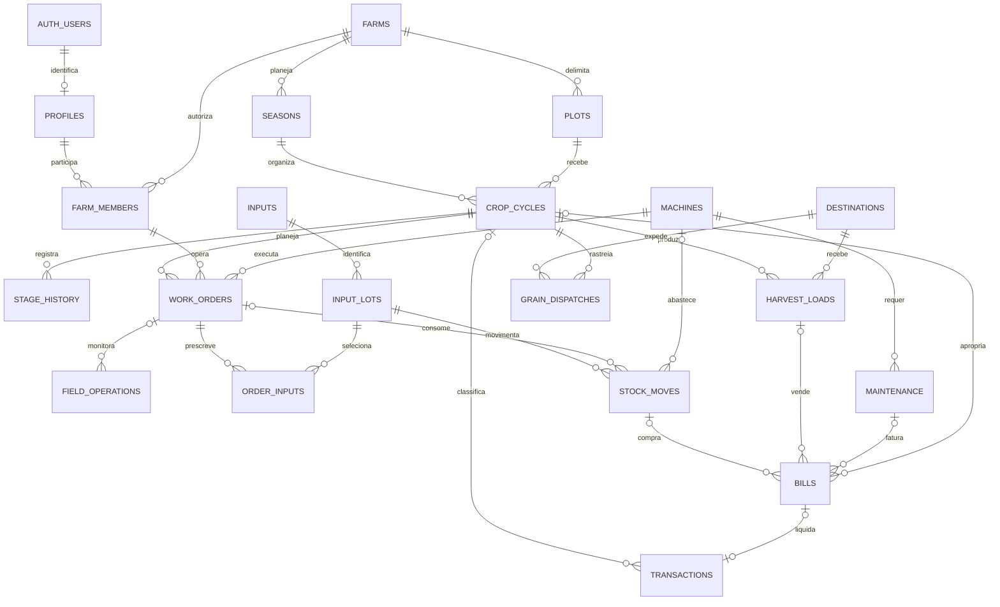

# Banco de dados · Gestia

## Instalação sobre uma base existente

O dump de referência descreve cinco tabelas existentes. As migrations são incrementais e dependem dessa base, de `auth.users`, `auth.uid()`, dos papéis Supabase e de PostgreSQL 15 ou superior. Execute com o proprietário das tabelas, primeiro em uma cópia de homologação.

1. Confira o histórico de migrations. `202611200001_field_operations.sql` cria a tabela de telemetria já usada pelo painel. Se ela já existe, confira a estrutura e o histórico antes de aplicar novamente.
2. Confira papéis, políticas, privilégios de coluna, funções privilegiadas já expostas e as FKs existentes. O dump fornecido não inclui esse catálogo. A nova migration referencia os nomes `transactions_plot_id_fkey` e `field_operations_plot_id_fkey`.
3. Execute `202611200002_rural_erp.sql` uma vez, após a anterior. O bloco é transacional. Se houver vínculo entre fazendas em registros antigos, a FK composta rejeita a aplicação inteira. Corrija a origem com o responsável pelos dados.
4. Execute o teste de contrato em uma base dedicada. Depois valide login, seleção de fazenda, CRUD legado e relacionamentos embutidos do PostgREST com usuários reais de homologação. Políticas restritivas preexistentes continuam valendo.
5. Antes da produção, salve um backup restaurável e meça a janela de bloqueio das FKs/índices sobre o volume real. Uma falha antes do commit desfaz o bloco. Após gravações no ERP, uma reversão requer restauração coordenada ou migration corretiva.

Consultas de pré-verificação:

```sql
select unnest(enum_range(null::public.user_role));
select tablename, policyname, permissive, roles, cmd, qual, with_check
from pg_policies where schemaname = 'public' order by tablename, policyname;
select table_name,column_name,grantee,privilege_type from information_schema.column_privileges
where table_schema='public' and grantee in ('anon','authenticated','PUBLIC');
select t.id, t.farm_id, p.farm_id as plot_farm
from public.transactions t join public.plots p on p.id = t.plot_id
where p.farm_id <> t.farm_id;
select o.id, o.farm_id, p.farm_id as plot_farm
from public.field_operations o join public.plots p on p.id = o.plot_id
where p.farm_id <> o.farm_id;
```

## DER

Os vínculos com campos opcionais aparecem com cardinalidade zero-ou-um. Em referências de domínio, `farm_id` participa da FK com o identificador da entidade de destino. Cada ordem chega ao talhão pelo ciclo.



## Dicionário de entidades

Valores monetários são em BRL. As operações monetárias, de peso e de quantidade usam `numeric`. UUID identifica documentos sem depender de sequência global. Datas civis (`date`) representam competência, vencimento ou pesagem. Instantes de eventos e telemetria usam `timestamptz`. Configure o fuso operacional da conexão ao determinar “hoje”.

| Entidade | Campos de negócio e interpretação |
|---|---|
| `profiles` | PK = usuário de autenticação. Nome compartilhável dentro da equipe. |
| `farms` | Nome, latitude/longitude decimais e criador. Coordenadas opcionais alimentam mapa e previsão. |
| `farm_members` | PK (fazenda, usuário), papel do enum existente. Também valida o operador da OS. |
| `plots` | Nome e vértices JSONB. Identidade permanece estável após edição do limite. |
| `seasons` | Nome único na fazenda, datas de início/fim, indicador ativo com índice único parcial. |
| `crop_cycles` | Um registro por fazenda/safra/talhão. Cultura, estágio, área de referência em ha, kg/saca, sc/ha previstos, preço por saca e orçamento total em R$. |
| `stage_history` | Ciclo, estágio, data de observação pelo sistema e autor. Trigger apensa na criação ou mudança do estágio. |
| `inputs` | SKU, família, unidade-base, mínimo, quantidade e valor contábil. Custo médio gerado por divisão, nulo sem saldo. |
| `input_lots` | SKU, código único dentro do SKU, validade opcional e quantidade. Lote vencido bloqueia a saída. |
| `stock_moves` | Evento, lote, quantidade positiva, custo unitário e valor estendido. Origem inclui nota na entrada, OS no consumo ou máquina/leitura no abastecimento. O tipo define o sentido do movimento. |
| `work_orders` | Ciclo, operador, máquina, tipo, data, hectares e estado. Na execução captura contador inicial. Na conclusão congela horas, custos e instante. |
| `order_inputs` | PK (OS, lote). Dose na unidade do SKU por hectare. Quantidade baixada = dose × área da OS, com quatro casas. |
| `field_operations` | Leitura operacional preexistente com progresso, máquina, início, última atualização, pendência de insumo e manutenção. `order_id` liga uma leitura à OS; leituras antigas continuam válidas. |
| `machines` | Veículo, máquina ou implemento; nome, tipo livre, unidade de contador, leitura e tarifa/hora. A tarifa fica congelada como custo na conclusão da OS. |
| `maintenance` | Preventiva/corretiva por máquina, serviço, custo e conclusão. Pelo menos um limite de data ou contador. |
| `destinations` | Nome único por propriedade e tipo (silo, cooperativa ou trading). |
| `harvest_loads` | Ciclo, destino, romaneio e data. Bruto, tara, desconto e líquido em kg. Umidade e impurezas em %. Número do romaneio é único por fazenda e destino. |
| `grain_dispatches` | Remessa de um ciclo em um destino de origem, documento, data, kg, destinatário. O trigger serializa saídas pelo destino e verifica saldo. |
| `bills` | Uma parcela a pagar/receber, valor, vencimento, natureza, ciclo opcional e origem documental opcional (entrada, romaneio ou manutenção). Liquidação integral grava data e FK única para o caixa. |
| `transactions` | Caixa efetivo por fazenda e data. Talhão opcional, ciclo e natureza opcionais para compatibilidade. Com ciclo, o talhão deve coincidir e valor/tipo precisam ser válidos. Movimentos de títulos liquidados ficam protegidos contra edição e exclusão. |

## Visões, comandos e acesso

| Objeto | Contrato |
|---|---|
| `farm_alerts` | Uma linha por ocorrência, com fazenda, tipo, fonte, texto e prazo. Filtrar a fazenda antes de ordenar por urgência. |
| `lot_demand` | Demanda das ordens planejadas/em execução, inclusive atrasadas, até sete dias à frente. Calcula quantidade exigida, disponível e faltante por lote. A validade deve ser conferida na data prevista. |
| `cycle_economics` | Uma linha por ciclo. Custos de OS concluídas + abastecimentos atribuídos + despesas diretas pagas. Custo/ha = custo ÷ área. Margem projetada = ha × sc/ha × preço − orçamento. Margem realizada = vendas recebidas − custos apropriados. Ambas em R$. |
| `grain_balances` | Kg líquidos recebidos menos expedidos, agrupados por fazenda/destino/ciclo. Inclui custódia externa. |
| `receive_stock` | UUID da requisição, fazenda, lote, quantidade, preço unitário, nota. Retorna ID do movimento. |
| `refuel_machine` | UUID da requisição, fazenda, lote de combustível em litros, quantidade, máquina, leitura e ciclo opcional. Baixa e atualização do contador na mesma transação. |
| `advance_order` | Fazenda, OS, estado desejado, horas na conclusão, odômetro final quando aplicável. Estados terminais preservam o histórico. |
| `settle_bill` | Fazenda, título e data efetiva. Retorna o ID da transação existente ou recém-criada. |

Os contratos em `src/features/*/contracts.ts` representam **linhas de leitura**. Para escrever, envie apenas as colunas autorizadas pelo GRANT correspondente ou os argumentos em `src/shared/contracts/erp.ts`. Campos gerados, saldos e totais de conclusão pertencem ao banco.

- **Visitante** — sem acesso direto às tabelas. A demonstração existente usa dados locais.
- **Membro** — consulta dados da própria fazenda e perfis de colegas. Um usuário pode consultar e atualizar o próprio nome.
- **Escrita** — a allowlist de papéis é `owner`, `manager` e `editor` quando os respectivos rótulos existem. Demais papéis são somente leitura. Confirme o enum real antes de implantar. A migration não acrescenta valores ao enum legado.
- **Participação** — o cliente pode criar a própria participação `owner` apenas numa fazenda criada por ele e ainda sem membros. Administração posterior da equipe requer fluxo privilegiado de convite. Chaves de serviço pertencem ao backend.
- **RPCs** — as quatro rotinas públicas verificam o usuário autenticado e a fazenda, fixam o caminho de schemas e restringem EXECUTE. Visões usam `security_invoker`. Funções auxiliares residem em schema reservado. Mantenha `agro_internal` fora dos schemas expostos no PostgREST.
- **Privilégios anteriores** — revise grants excepcionais herdados por outros papéis, colunas concedidas isoladamente e RPCs legadas com `SECURITY DEFINER`. O dump de tabelas não permite inferir esses caminhos de acesso. Não use a chave de serviço para testar RLS.

## Verificação

Em uma base PostgreSQL/Supabase de teste com ambas as migrations aplicadas, execute `psql -X -v ON_ERROR_STOP=1 -f supabase/tests/erp_contract.sql` com um usuário de manutenção autorizado a alternar para `authenticated`. O teste cria identidades e dados próprios na transação e termina com rollback. Exercita constituição da fazenda, papel de leitura, isolamento entre propriedades, referência cruzada inválida, média ponderada, rollback de OS sem saldo, repetição de conclusão e liquidação, abastecimento, armazenagem e resultado por ciclo.
